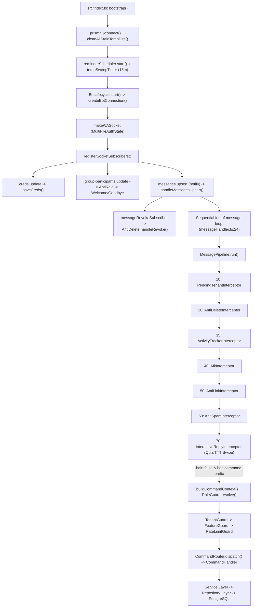

# 01 — Architecture & Data Model Analysis

Dokumen ini menganalisis struktur arsitektur aktual MinjiBot, siklus hidup koneksi WhatsApp (`@whiskeysockets/baileys`), alur pemrosesan pesan masuk (_Interceptor Pipeline_ & _Command Router_), kepatuhan terhadap arsitektur berlapis (_Layering Architecture_), serta desain skema dan migrasi basis data PostgreSQL/Prisma.

---

## 1. Gambaran Umum Teknologi & Struktur Direktori

MinjiBot dibangun di atas runtime **Node.js (TypeScript `strict: true`, CommonJS)** dengan ketergantungan inti yang relatif ramping (`10` runtime dependencies pada `package.json:20-31`):

- **Protokol WhatsApp Web**: `@whiskeysockets/baileys` (terkunci `6.7.23`, dideklarasikan `^6.7.0`).
- **ORM & Basis Data**: `@prisma/client` / `prisma` (`6.19.3`) di atas **PostgreSQL**.
- **Pemrosesan Media & Grafis**: `sharp` (`0.34.5`) untuk manipulasi gambar & render kartu berbasis SVG, `node-webpmux` (`3.2.1`) untuk injeksi metadata EXIF stiker WebP, `ffmpeg-static` (`5.3.0`) untuk transcoding audio/video, serta biner eksternal sistem `yt-dlp` dan `gallery-dl`.
- **Validasi & Observabilitas**: `zod` (`3.25.76`) untuk validasi variabel lingkungan dan `pino` (`9.14.0`) untuk structured logging.

### Peta Modul Kode Sumber (`144` File di `src/`)

| Direktori                   | Jumlah File | Tanggung Jawab Aktual                                                                                                                                                                                                                            |
| :-------------------------- | :---------: | :----------------------------------------------------------------------------------------------------------------------------------------------------------------------------------------------------------------------------------------------- |
| `src/config/`               |      3      | Validasi `env.ts` (Zod), konfigurasi `logger.ts` (Pino), dan singleton `database.ts` (`PrismaClient`).                                                                                                                                           |
| `src/bot/`                  |     16      | Siklus hidup soket Baileys (`connection.ts`, `lifecycle.ts`), _event subscribers_ (`subscribers/`), _Message Pipeline_ (`pipeline/`), `messageHandler.ts`, dan `contextBuilder.ts`.                                                              |
| `src/guards/`               |      5      | Resolusi peran (`roleGuard.ts`), status sewa grup (`tenantGuard.ts`), sakelar fitur grup (`featureGuard.ts`), hak moderasi (`moderationGuard.ts`), dan _rate limit_ perintah (`rateLimitGuard.ts`).                                              |
| `src/commands/`             |     30      | `commandRouter.ts`, registri perintah (`index.ts`), dan `28` modul handler perintah terkelompok per domain (`general`, `tenant`, `member`, `media`, `moderation`, `game`, `stats`, `utility`, `afk`).                                            |
| `src/services/`             |     48      | Logika bisnis inti: manajemen tenant, ekonomi member, media downloader/enhancer/sticker/audio, moderasi otomatis & manual, mini-games, reminder scheduler, serta 2 layanan internal legacy (`alertServer.ts`, `telemetry.service.ts`).           |
| `src/repositories/`         |     12      | Abstraksi akses tabel Prisma (`tenantGroup`, `tenantFeatureSetting`, `tenantGroupSetting`, `tenantAdmin`, `tenantPrivateSession`, `tenantAuditLog`, `groupMemberProfile`, `groupMemberWarning`, `reminder`, `afk`, dll.).                        |
| `src/utils/` & `src/types/` |     30      | Normalisasi JID (`jid.ts`), ekstraksi media/pesan (`messageParser.ts`, `mediaTarget.ts`), _LRU Cache_ (`lruCache.ts`), sanitasi error (`userSafeError.ts`), manajemen direktori sementara (`tempFile.ts`), waktu (`time.ts`), dan definisi tipe. |

---

## 2. Alur Kerja Bot WhatsApp & Siklus Hidup Pesan

Diagram berikut menggambarkan alur aktual sejak soket Baileys terhubung hingga sebuah pesan grup atau _Direct Message_ (DM) dieksekusi:

### Kekuatan Desain Saat Ini

1. **Modular Message Pipeline (`src/bot/pipeline/messagePipeline.ts`)**: Penggunaan pola _Chain of Responsibility_ terurut menjaga `src/bot/messageHandler.ts` tetap ringkas (`118` baris) dan memisahkan logika pra-pemrosesan (anti-link, anti-spam, AFK, jawaban kuis via _reply_) dari eksekusi perintah ber-prefix.
2. **Isolasi Ekonomi Berbasis Grup (`GroupMemberProfile`)**: Kunci komposit `@@unique([groupJid, userJid])` pada `prisma/schema.prisma:249` mengisolasi poin, limit, XP, dan streak secara bersih antar grup penyewa.
3. **Pola _Reserve ➔ Consume / Refund_ untuk Fitur Berat**: `src/utils/heavyFeatureHelper.ts` menerapkan cadangan limit (`reservedLimit`) sebelum pemrosesan berat dimulai dan mengembalikan saldo apabila eksekusi gagal.

---

## 3. Evaluasi Kepatuhan Arsitektur Berlapis (Layering Audit)

Aturan utama pada `AGENTS.md` Bagian 8.1 menyatakan:

> _"Command Handler (`src/commands/`): Hanya bertanggung jawab mem-parsing argumen konteks, memanggil service layer, dan membalas pesan. DILARANG KERAS memanggil Prisma Client langsung di dalam Command Handler! Repository Layer bertanggung jawab penuh atas query basis data Prisma."_

Hasil pemeriksaan seluruh `30` file di `src/commands/` menunjukkan:

- **Tidak ada impor langsung `prisma` (`src/config/database.ts`) di `src/commands/`** — ini sudah baik.
- **Namun terdapat pelanggaran lapisan _Command ➔ Repository_ (`ARCH-01`)** pada dua file:
  1. `src/commands/member/memberAdmin.command.ts:4-5,12-13,205,211,236`: Menginstansiasi `TenantGroupRepository` dan `TenantAdminRepository` secara langsung di dalam _Command Handler_ untuk menyelesaikan kode grup (`findByCode`) dan mengecek status admin (`isAdmin`) sebelum memanggil `memberAdminService.addLimitAll`, bahkan mendahului pemeriksaan otorisasi peran pengirim (`SEC-05`, `LOG-02`).
  2. `src/commands/member/profile.command.ts:10,12,250`: Menginstansiasi `TenantGroupRepository` secara langsung di _Command Handler_ untuk `findByGroupJid` saat merender kartu `.profile`.
- **Duplikasi Logika Lintas Lapisan (`ARCH-01`)**:
  - Fungsi pengambilan foto profil WhatsApp dan pembacaan _fallback avatar_ `assets/minji.png` diduplikasi di **4 file berbeda** (`src/commands/member/profile.command.ts:109-125`, `src/services/member/profileCard.service.ts:249-260`, `src/services/welcome/welcome.service.ts:404-432`, dan `src/commands/media/quoteCard.command.ts:134-158`) dengan perilaku _timeout_ dan I/O sinkron (`fs.readFileSync`) yang berbeda-beda (`PERF-02`).
- **Ketidakkonsistenan _Error Boundary_ pada Command Handler (`ARCH-01`)**:
  - `CommandRouter.dispatch` (`src/commands/commandRouter.ts:36-46`) tidak membungkus `command.execute(context)` dalam blok `try/catch` ramah pengguna; jika sebuah command melempar exception yang tidak tertangkap, error merambat hingga `messageHandler.ts:108` dan pengguna tidak menerima umpan balik sama sekali (atau pada beberapa command menerima `error.message` mentah, lihat `SEC-07`). Tercatat **10 command handler** tidak memiliki blok `try/catch` sama sekali (`superOwnerTenant.command.ts:65,158,218`, `tenantOwner.command.ts:40`, `reminder.command.ts:42,68`, `welcome.command.ts:34-82`).

---

## 4. Kelemahan Struktural Lintas Modul (Cross-Cutting Architectural Gaps)

### 4.1. Ketiadaan Shared Context Antar Interceptor & Guard (`PERF-01`)

Setiap pesan teks biasa di grup memicu pemanggilan berulang ke tabel `TenantGroup`, `TenantFeatureSetting`, dan `TenantGroupSetting` dari masing-masing interceptor secara terpisah (`PendingTenantInterceptor` ➔ `AntiDeleteInterceptor` ➔ `ActivityTrackerInterceptor` ➔ `AfkInterceptor` ➔ `AntiLinkInterceptor` ➔ `AntiSpamInterceptor` ➔ `TenantGuard` ➔ `FeatureGuard`). Tidak adanya objek konteks tenant ter-cache per pesan menyebabkan:

- **5 hingga 7 query database per pesan chat biasa**, dan
- Interceptor tetap berjalan pada grup berstatus `PENDING`, `EXPIRED`, `BLOCKED`, maupun `REMOVED`.

### 4.2. Ketiadaan Layanan Kanonik Resolusi Identitas Dual-JID (`LOG-06`)

WhatsApp Multi-Device modern menggunakan dua skema identitas secara bersamaan di dalam grup: Phone JID (`628xxx@s.whatsapp.net`) dan Linked Identity / Privacy JID (`123456789@lid`). Meskipun `src/bot/contextBuilder.ts` telah menyiapkan `senderUserJid` dan `senderAltJids`, **tidak ada layanan terpusat (`IdentityResolver`)** yang memetakan metadata partisipan grup (`{ id, jid, lid }`) ke satu `userJid` kanonik. Akibatnya, minimal **10 modul fitur** membandingkan string JID mentah dan mengalami kegagalan logika serius (dibahas mendalam di [`03-logic-and-flow-audit.md`](./03-logic-and-flow-audit.md)).

### 4.3. Modul Internal/Legacy yang Mencemari Boundary Aplikasi (`SEC-01`)

Terdapat tiga komponen yang melanggar batas tanggung jawab sebuah bot WhatsApp _standalone_:

- `src/utils/qrExporter.ts`: Menulis kode QR autentikasi sesi WhatsApp sebagai halaman HTML publik ke `/var/www/void-downloader/minji-auth/index.html`.
- `src/services/alertServer.ts`: Membuka server HTTP TCP pada `127.0.0.1:3847` untuk meneruskan pesan ke grup ter-hardcode.
- `src/services/telemetry.service.ts`: Mengirim HTTP POST ke endpoint eksternal pada setiap pesan masuk dan keluar.

Sesuai keputusan audit, ketiga modul ini beserta direktori `scratch/` dihapus sepenuhnya pada **Phase 1**.

---

## 5. Analisis Skema Prisma & Forensik Migrasi (`prisma/`)

Skema `prisma/schema.prisma` memiliki **11 model** dan **6 enum** yang secara umum terstruktur baik dengan relasi `onDelete: Cascade` dari `TenantGroup` (`groupJid`). Namun ditemukan beberapa cacat skema dan migrasi yang krusial:

1. **Migrasi SQL Rusak pada `20260903010000_remove_legacy_owner_quota/migration.sql:11-21` (`REL-04` — Critical)**:
   - File migrasi berisi `DO \$\$ BEGIN ... END \$\$;` (karakter `$` ter-escape backslash akibat pembuatan via heredoc shell). PostgreSQL menolak sintaks `\$\$`, sehingga `npx prisma migrate deploy` **pasti gagal** pada database kosong/baru (CI, staging, atau pengguna _open-source_ baru). Selama ini kegagalan ini tertutupi karena `.github/workflows/deploy.yml:39` memaksa `npx prisma db push --skip-generate --accept-data-loss`.
2. **Duplikasi Prefix Timestamp Migrasi (`REL-04`)**:
   - Dua direktori migrasi berbagi prefix waktu yang identik: `20260905010000_add_group_member_warning` dan `20260905010000_remove_antiviewonce`, menghasilkan urutan eksekusi leksikografis yang rapuh.
3. **Ketiadaan Foreign Key & Redundansi Indeks pada `TenantPrivateSession` (`PERF-03`)**:
   - `prisma/schema.prisma:163-174`: `userJid` sudah `@unique` (otomatis membuat indeks unik B-Tree di PostgreSQL), sehingga `@@index([userJid])` di baris `171` murni duplikat yang memperlambat operasi tulis. Selain itu, `groupJid` tidak memiliki relasi `@relation` `onDelete: Cascade` ke `TenantGroup`, meninggalkan sesi yatim (_orphaned session_) jika sebuah `TenantGroup` dihapus.
4. **Ketiadaan Indeks Komposit untuk Analitik Sider (`.silent`) (`PERF-03`)**:
   - `GroupMemberProfile` (`prisma/schema.prisma:249-254`) memiliki indeks untuk `experience`, `pointsBalance`, dan `messageCount`, tetapi **tidak memiliki `@@index([groupJid, lastActiveAt])`** yang dibutuhkan query `findInactiveMembers` (`groupMemberProfile.repository.ts:242-254`).
5. **Ketidaksinkronan Nama Model dengan Dokumentasi (`DOC-01`)**:
   - `AGENTS.md` §4.3 menyebut tabel buku besar sebagai `MemberTransactionLedger` dengan kolom `amountDelta`, sedangkan skema aktual di `prisma/schema.prisma:256-281` adalah `GroupMemberTransaction` dengan kolom `amount`.

---

## 6. Referensi Temuan Terkait

- [`ARCH-01`](./09-audit-findings.md#arch-01) — Pelanggaran layering Command-ke-Repository, duplikasi avatar helper & ketiadaan `try/catch` di 10 command.
- [`REL-04`](./09-audit-findings.md#rel-04) — Kerusakan SQL migrasi `20260903010000`, duplikasi timestamp `20260905010000_*` & konfigurasi PM2.
- [`PERF-01`](./09-audit-findings.md#perf-01) — Badai query SQL per pesan & ketiadaan _shared tenant context_ pada pipeline.
- [`PERF-03`](./09-audit-findings.md#perf-03) — Indeks `GroupMemberProfile` & relasi `TenantPrivateSession`.
- [`LOG-06`](./09-audit-findings.md#log-06) — Ketiadaan resolusi kanonik Dual-JID (`@lid` vs `@s.whatsapp.net`).
