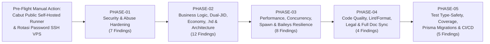

# MinjiBot — Master Remediation Plan

> **Peran Dokumen Ini**: `audit/REMEDIATION_PLAN.md` adalah **Master Plan dan Sumber Acuan Utama** untuk seluruh tahap implementasi perbaikan pasca-audit MinjiBot. Setiap pengembang maupun _AI Agent_ wajib mematuhi urutan fase, batasan ruang lingkup, dan matriks pelacakan pada dokumen ini.

---

## 1. Strategi & Arsitektur Urutan Fase Perbaikan

Seluruh **37 temuan** dalam [`09-audit-findings.md`](./09-audit-findings.md) (`36` temuan aktif + `1` temuan `Not Applicable`) telah dikelompokkan ke dalam **5 Fase Implementasi Berurutan** yang meminimalkan konflik pengeditan antarberkas dan menjaga aplikasi tetap dapat dibangun (`npm run build` hijau) di setiap akhir fase:



### Mengapa Urutan Ini Dipilih?

1. **`PHASE-01` mendahului segalanya** karena menutup kebocoran QR/telemetri (`SEC-01`), celah SSRF/cookie (`SEC-03`), bom memori Sharp & upgrade pustaka (`SEC-04`), bypass DM (`SEC-05`), dan bug kritis `AntiDelete` yang mem-posting ulang konten terlarang (`LOG-05`). Menghapus file mati (`qrExporter`, `alertServer`, `telemetry`, `scratch/`) di awal juga mengurangi beban kerja di fase berikutnya.
2. **`PHASE-02` meletakkan fondasi kebenaran domain** (`IdentityResolver` Dual-JID `LOG-06`, atomisitas buku besar ekonomi `LOG-01`/`LOG-02`/`LOG-07`, biaya `.yt` `LOG-03`, pipeline baru _Sharp Super-Clarity_ `.hd` `LOG-04`, guard `LOG-08`, moderasi/game `LOG-09`, refactoring layering `ARCH-01`, serta keamanan `.tweet`/privasi/avatar `UXL-03..05`) sebelum lapisan konkurensi dan caching dioptimalkan.
3. **`PHASE-03` mengoptimalkan performa & ketahanan infrastruktur** di atas logika bisnis yang sudah benar: _shared tenant context_ & batching aktivitas (`PERF-01`), semaphore media & batas stream (`PERF-02`), indeks DB (`PERF-03`), `processRunner` anti-deadlock (`REL-01`), rekonsiliasi startup `reservedLimit` (`REL-02`), serta pengerasan soket Baileys (`REL-03`, `REL-05`) & kompatibilitas lintas OS/codec (`COMP-01`).
4. **`PHASE-04` membersihkan seluruh kode & menyelaraskan dokumentasi** setelah antarmuka kode stabil: menuntaskan `278` masalah ESLint & `104` file Prettier (`QUAL-01`), menambahkan `LICENSE` & `PRIVACY.md` (`UXL-01`, `UXL-02`), serta menyinkronkan `AGENTS.md`, `README.md`, `.env.example`, dan `.menu` (`DOC-01`) sehingga tidak perlu diedit dua kali.
5. **`PHASE-05` mengunci kesiapan produksi (_Production Lock_)**: memperbaiki `39` error TypeScript di `tests/` (`QA-01`), memperluas suite pengujian regresi atas seluruh fitur baru/diperbaiki (`QA-02`), memperbaiki migrasi SQL Prisma & `ecosystem.config.cjs` (`REL-04`), mengaktifkan `.github/workflows/ci.yml` + SSH `deploy.yml` berbasis `prisma migrate deploy` (`SEC-02`), serta menambahkan `Dockerfile`/`docker-compose.yml` (`COMP-02`).

---

## 2. Matriks Pelacakan Induk (100% Finding Traceability Matrix)

Setiap baris di bawah ini menghubungkan **100% ID Temuan** dari [`09-audit-findings.md`](./09-audit-findings.md) ke tepat satu dokumen fase pemilik utama:

| ID Temuan                                   | Klasifikasi    | Severity | Dokumen Fase Pemilik                                        |     Status      | Ringkasan Penanganan yang Disetujui                                                                                                                                |
| :------------------------------------------ | :------------- | :------: | :---------------------------------------------------------- | :-------------: | :----------------------------------------------------------------------------------------------------------------------------------------------------------------- |
| [`SEC-01`](./09-audit-findings.md#sec-01)   | Confirmed      | Critical | [`PHASE-01`](./phases/PHASE-01-security-stability.md)       | `[x] Completed` | Hapus `qrExporter.ts`, `alertServer.ts`, `telemetry.service.ts`, `scratch/` & variabel terkait.                                                                    |
| [`SEC-02`](./09-audit-findings.md#sec-02)   | Confirmed      | Critical | [`PHASE-05`](./phases/PHASE-05-testing-production-ready.md) | `[x] Completed` | Cabut public self-hosted runner; buat `ci.yml` (`ubuntu-latest`) & SSH `deploy.yml` + `prisma migrate deploy`.                                                     |
| [`SEC-03`](./09-audit-findings.md#sec-03)   | Confirmed      |   High   | [`PHASE-01`](./phases/PHASE-01-security-stability.md)       | `[x] Completed` | Validator URL domain ketat + anti-private-IP DNS + `--ies` & `--no-playlist` pada `yt-dlp`/`gallery-dl`.                                                           |
| [`SEC-04`](./09-audit-findings.md#sec-04)   | Confirmed      |   High   | [`PHASE-01`](./phases/PHASE-01-security-stability.md)       | `[x] Completed` | Upgrade `sharp`/deps aman, kunci Baileys `^6.7.23`, pasang `limitInputPixels: 4096*4096` & cap halaman animasi.                                                    |
| [`SEC-05`](./09-audit-findings.md#sec-05)   | Confirmed      |   High   | [`PHASE-01`](./phases/PHASE-01-security-stability.md)       | `[x] Completed` | Filter sesi/role DM pada tenant `ACTIVE` non-blocked belum expired; pasang guard DM di `.quote`/`.tweet`; cek auth sebelum kode.                                   |
| [`SEC-06`](./09-audit-findings.md#sec-06)   | Confirmed      |  Medium  | [`PHASE-01`](./phases/PHASE-01-security-stability.md)       | `[x] Completed` | Utilitas tunggal `escapeXml`, batas panjang teks SVG, _hard word-break_, & koreksi posisi badge `.tweet`.                                                          |
| [`SEC-07`](./09-audit-findings.md#sec-07)   | Confirmed      |  Medium  | [`PHASE-01`](./phases/PHASE-01-security-stability.md)       | `[x] Completed` | Ganti substring denylist dengan `AppUserError` allowlist + arahkan semua catch ke `formatUserSafeError` + OpSec SSH VPS.                                           |
| [`LOG-01`](./09-audit-findings.md#log-01)   | Confirmed      | Critical | [`PHASE-02`](./phases/PHASE-02-logic-and-architecture.md)   | `[x] Completed` | Hapus bypass saldo `TENANT_OWNER` di `.slot`, `MAX_SLOT_BET`, transaksi atomik + ledger `GroupMemberTransaction` + level-up.                                       |
| [`LOG-02`](./09-audit-findings.md#log-02)   | Confirmed      | Critical | [`PHASE-02`](./phases/PHASE-02-logic-and-architecture.md)   | `[x] Completed` | Kunci `.addlimitall` khusus `SUPER_OWNER`, bungkus `$transaction` + catat `GroupMemberTransaction` & `TenantAuditLog`.                                             |
| [`LOG-03`](./09-audit-findings.md#log-03)   | Confirmed      | Critical | [`PHASE-02`](./phases/PHASE-02-logic-and-architecture.md)   | `[x] Completed` | Tipe penuh `Record<HeavyFeatureType, number>` pada `HEAVY_FEATURE_COST`; set `YOUTUBE_VIDEO_DOWNLOAD: 1`.                                                          |
| [`LOG-04`](./09-audit-findings.md#log-04)   | Confirmed      |   High   | [`PHASE-02`](./phases/PHASE-02-logic-and-architecture.md)   | `[x] Completed` | `.hd` potong `1 Limit` + pipeline _Sharp Super-Clarity_ (`autoOrient`, `fit: "inside"`, `mks2021`, `2560px`/`3840px`, `CLAHE`, LAB `sharpen`, `4:4:4` MozJPEG 95). |
| [`LOG-05`](./09-audit-findings.md#log-05)   | Confirmed      | Critical | [`PHASE-01`](./phases/PHASE-01-security-stability.md)       | `[x] Completed` | Eviksi pesan hapus moderasi dari `AntiDelete`, abaikan revoke oleh admin/bot, dan hentikan pembongkaran `viewOnceMessage*`.                                        |
| [`LOG-06`](./09-audit-findings.md#log-06)   | Confirmed      | Critical | [`PHASE-02`](./phases/PHASE-02-logic-and-architecture.md)   | `[x] Completed` | Bangun `IdentityResolverService` untuk meresolusi `@lid` <-> `@s.whatsapp.net` di seluruh 10 modul + perbaiki `normalizeUserJid`.                                  |
| [`LOG-07`](./09-audit-findings.md#log-07)   | Confirmed      | Critical | [`PHASE-02`](./phases/PHASE-02-logic-and-architecture.md)   | `[x] Completed` | Satu `$transaction` untuk `.daily`, tangkap `P2002` idempotensi, guard `correlationId` `CONSUME` vs `REFUND`, rapikan `.play`.                                     |
| [`LOG-08`](./09-audit-findings.md#log-08)   | Confirmed      |   High   | [`PHASE-02`](./phases/PHASE-02-logic-and-architecture.md)   | `[x] Completed` | Perbaiki `TenantGuard`, `FeatureGuard`, `unblockTenant`/`extendTenant`/`setTenantExpire`/`transferOwner`, & wiring `invalidateCache`.                              |
| [`LOG-09`](./09-audit-findings.md#log-09)   | Confirmed      |   High   | [`PHASE-02`](./phases/PHASE-02-logic-and-architecture.md)   | `[x] Completed` | Perbaiki urutan imunitas `AntiLink`/`AntiSpam`/`AntiRaid`/`.del`/`.warn`, game `.nyerah`/reward/mutex, `.profile`, `INT4` & zona WIB.                              |
| [`PERF-01`](./09-audit-findings.md#perf-01) | Confirmed      | Critical | [`PHASE-03`](./phases/PHASE-03-performance-reliability.md)  | `[x] Completed` | `TenantContextInterceptor` ter-cache, hentikan grup mati di awal, batch `ActivityTracker` 15s, cap RAM `AntiDelete` `64 MB`.                                       |
| [`PERF-02`](./09-audit-findings.md#perf-02) | Confirmed      |   High   | [`PHASE-03`](./phases/PHASE-03-performance-reliability.md)  | `[x] Completed` | Semaphore konkurensi media/Sharp, stream reader berbatas byte + timeout, async cached avatar, paralelisme terbatas `upsert`.                                       |
| [`PERF-03`](./09-audit-findings.md#perf-03) | Confirmed      |  Medium  | [`PHASE-03`](./phases/PHASE-03-performance-reliability.md)  | `[x] Completed` | Indeks `(groupJid, lastActiveAt)`, FK `TenantPrivateSession`, hapus kueri ganda/N+1, `LruCache` untuk `lastPlayedService`.                                         |
| [`REL-01`](./09-audit-findings.md#rel-01)   | Confirmed      |   High   | [`PHASE-03`](./phases/PHASE-03-performance-reliability.md)  | `[x] Completed` | Sentralisasi `processRunner.ts` (ignore/drain `stdout`, cap `stderr`, kill process tree, tunggu `close`), amankan `tempFile.ts`.                                   |
| [`REL-02`](./09-audit-findings.md#rel-02)   | Confirmed      |   High   | [`PHASE-03`](./phases/PHASE-03-performance-reliability.md)  | `[x] Completed` | Rekonsiliasi startup `reservedLimit` menggantung (`FEATURE_REFUND`), retry settlement di `heavyFeatureHelper`, `P2002` `findOrCreate`.                             |
| [`REL-03`](./09-audit-findings.md#rel-03)   | Confirmed      |   High   | [`PHASE-03`](./phases/PHASE-03-performance-reliability.md)  | `[x] Completed` | Pasang `cachedGroupMetadata` + `getMessage` LRU di `makeWASocket`, timeout versi Baileys, guard `BotLifecycle` & `ReminderScheduler`.                              |
| [`REL-04`](./09-audit-findings.md#rel-04)   | Confirmed      | Critical | [`PHASE-05`](./phases/PHASE-05-testing-production-ready.md) | `[x] Completed` | Perbaiki `DO $$ BEGIN` di migrasi `20260903010000`, urutkan timestamp `20260905010000_*`, tambah `ecosystem.config.cjs`.                                           |
| [`REL-05`](./09-audit-findings.md#rel-05)   | Potential      |  Medium  | [`PHASE-03`](./phases/PHASE-03-performance-reliability.md)  | `[x] Completed` | Serialisasikan penulisan `saveCreds()` dengan antrean mutex asinkron & tunggu selesai saat `stop()`.                                                               |
| [`ARCH-01`](./09-audit-findings.md#arch-01) | Confirmed      |  Medium  | [`PHASE-02`](./phases/PHASE-02-logic-and-architecture.md)   | `[x] Completed` | Hapus impor repository dari `src/commands/`, satukan `AvatarService`, & pasang error boundary di `CommandRouter.dispatch()`.                                       |
| [`QUAL-01`](./09-audit-findings.md#qual-01) | Confirmed      |   High   | [`PHASE-04`](./phases/PHASE-04-code-quality.md)             | `[x] Completed` | Tuntaskan 278 masalah ESLint & 104 file Prettier, lengkapi ignore & `package.json`, bersihkan 38 paket extraneous.                                                 |
| [`DOC-01`](./09-audit-findings.md#doc-01)   | Confirmed      |   High   | [`PHASE-04`](./phases/PHASE-04-code-quality.md)             | `[x] Completed` | Sinkronkan `AGENTS.md` (+ aturan Remediation Workflow), `README.md`, `PLAN.md`, `.env.example`, `.menu`, & `.panel`.                                               |
| [`COMP-01`](./09-audit-findings.md#comp-01) | Confirmed      |  Medium  | [`PHASE-03`](./phases/PHASE-03-performance-reliability.md)  | `[x] Completed` | Perbaiki `PATH` Windows, deteksi codec H.264 `.mp4`, koreksi `fromMe` `mediaTarget`, nomor E.164, & dok font Linux.                                                |
| [`COMP-02`](./09-audit-findings.md#comp-02) | Improvement    |   Low    | [`PHASE-05`](./phases/PHASE-05-testing-production-ready.md) | `[x] Completed` | Tambahkan `Dockerfile`, `.dockerignore`, dan `docker-compose.yml` siap pakai.                                                                                      |
| [`ACC-01`](./09-audit-findings.md#acc-01)   | Not Applicable |   Info   | _Tidak Ada Perubahan Kode_                                  |    `[x] N/A`    | Headless WhatsApp bot tanpa antarmuka web publik; dijustifikasi penuh di `06-compatibility-and-accessibility.md`.                                                  |
| [`UXL-01`](./09-audit-findings.md#uxl-01)   | Confirmed      |   High   | [`PHASE-04`](./phases/PHASE-04-code-quality.md)             | `[x] Completed` | Buat berkas `LICENSE` (MIT License) di root & perbarui field `"license": "MIT"` di `package.json`.                                                                 |
| [`UXL-02`](./09-audit-findings.md#uxl-02)   | Confirmed      |   High   | [`PHASE-04`](./phases/PHASE-04-code-quality.md)             | `[x] Completed` | Tambahkan Disclaimer resmi risiko pemblokiran nomor WhatsApp Unofficial API (`Baileys`) di `README.md`.                                                            |
| [`UXL-03`](./09-audit-findings.md#uxl-03)   | Confirmed      |   High   | [`PHASE-02`](./phases/PHASE-02-logic-and-architecture.md)   | `[x] Completed` | Batasi `.tweet` pada identitas sendiri atau reply pesan asli + tambahkan watermark `GENERATED BY MINJIBOT • PARODY`.                                               |
| [`UXL-04`](./09-audit-findings.md#uxl-04)   | Confirmed      |  Medium  | [`PHASE-02`](./phases/PHASE-02-logic-and-architecture.md)   | `[x] Completed` | Tambah `.deletemydata`, `.purgetenant`, retensi log 90 hari, sanitasi JID test (+ tulis `PRIVACY.md` di `PHASE-04`).                                               |
| [`UXL-05`](./09-audit-findings.md#uxl-05)   | Potential      |  Medium  | [`PHASE-02`](./phases/PHASE-02-logic-and-architecture.md)   | `[x] Completed` | Hapus `src/Minji.png`, ganti `assets/minji.png` dengan avatar vektor bebas hak cipta + env `BOT_AVATAR_PATH`.                                                      |
| [`QA-01`](./09-audit-findings.md#qa-01)     | Confirmed      |   High   | [`PHASE-05`](./phases/PHASE-05-testing-production-ready.md) | `[x] Completed` | Buat `tests/helpers/factories.ts`, perbaiki seluruh 39 error TS di 15 file test, wajibkan `npm run typecheck`.                                                     |
| [`QA-02`](./09-audit-findings.md#qa-02)     | Confirmed      |   High   | [`PHASE-05`](./phases/PHASE-05-testing-production-ready.md) | `[x] Completed` | Perbaiki asersi semu & perluas unit/integration tests untuk router, commands, media/HD, Dual-JID, lifecycle & migrasi.                                             |

---

## 3. Ringkasan Cakupan per Dokumen Fase

1. **[`phases/PHASE-01-security-stability.md`](./phases/PHASE-01-security-stability.md)** — _Security Hardening, Secret/Legacy Purge & Abuse Prevention_
   - Menangani: `SEC-01`, `SEC-03`, `SEC-04`, `SEC-05`, `SEC-06`, `SEC-07`, `LOG-05` (**7 temuan**).
2. **[`phases/PHASE-02-logic-and-architecture.md`](./phases/PHASE-02-logic-and-architecture.md)** — _Business Logic, Dual-JID Normalization, Economy Atomicity, HD Super-Clarity & Architecture_
   - Menangani: `LOG-01`, `LOG-02`, `LOG-03`, `LOG-04`, `LOG-06`, `LOG-07`, `LOG-08`, `LOG-09`, `ARCH-01`, `UXL-03`, `UXL-04`, `UXL-05` (**12 temuan**).
3. **[`phases/PHASE-03-performance-reliability.md`](./phases/PHASE-03-performance-reliability.md)** — _Performance Optimization, Subprocess Safety, Database Indexing & Baileys Resilience_
   - Menangani: `PERF-01`, `PERF-02`, `PERF-03`, `REL-01`, `REL-02`, `REL-03`, `REL-05`, `COMP-01` (**8 temuan**).
4. **[`phases/PHASE-04-code-quality.md`](./phases/PHASE-04-code-quality.md)** — _Static Quality Gates, Legal/Privacy Compliance & Full Documentation Sync_
   - Menangani: `QUAL-01`, `UXL-01`, `UXL-02`, `DOC-01` (+ penyelesaian dokumen `PRIVACY.md` untuk `UXL-04`) (**4 temuan**).
5. **[`phases/PHASE-05-testing-production-ready.md`](./phases/PHASE-05-testing-production-ready.md)** — _Test Suite Type-Safety & Regression Coverage, Migration Repair, Hardened CI/CD & Containerization_
   - Menangani: `QA-01`, `QA-02`, `REL-04`, `SEC-02`, `COMP-02` (**5 temuan**).

---

## 4. Aturan Wajib AI Agent untuk `AGENTS.md` (Audit Remediation Workflow)

Pada saat tahap implementasi disetujui dan dimulai (serta dikunci secara permanen di `AGENTS.md` pada `PHASE-04`), aturan berikut berlaku sebagai **protokol kerja wajib** bagi setiap AI Agent yang mengerjakan tugas remediasi:

```markdown
## Audit Remediation Workflow

Before implementing any task related to audit remediation:

1. Read `audit/README.md`.
2. Read `audit/REMEDIATION_PLAN.md`.
3. Read the relevant phase document in `audit/phases/`.
4. Review all referenced findings in `audit/09-audit-findings.md` and verify them against the current source code.
5. Follow the defined implementation order, dependencies, and acceptance criteria.
6. Do not introduce changes outside the approved scope without discussing them first.
7. Update task status (`[x] Completed`) and verification results in `audit/REMEDIATION_PLAN.md` and the phase document after implementation.

Do not assume that an audit finding is automatically correct.
Verify its evidence before making changes.
```

---

## 5. Strategi Rollback & Pengamanan Perubahan

1. **Satu Commit / Branch Terisolasi per Fase**: Kerjakan setiap fase dalam commit atomik yang terpisah (`fix(phase-01): ...`, `fix(phase-02): ...`, dst.) pada branch kerja sebelum di-merge ke `main`, sehingga setiap fase dapat di-_revert_ bersih jika ditemukan regresi tak terduga.
2. **Backup Basis Data Sebelum `PHASE-03` & `PHASE-05`**: Sebelum menjalankan migrasi skema (`PERF-03` / `REL-04`) pada server produksi, wajib jalankan pencadangan penuh `pg_dump -Fc minjibot > backup_pre_migration_$(date +%F).dump`.
3. **Larangan Deploy Paralel**: Patuhi aturan `AGENTS.md` §8.5 — jangan pernah menjalankan perintah deploy manual via SSH berbarengan dengan eksekusi GitHub Actions pada branch `main`.

---

## 6. Kriteria Kelulusan Akhir Proyek (_Production Readiness Sign-Off_)

MinjiBot dinyatakan **SIAP PRODUKSI & SIAP PUBLIKASI OPEN-SOURCE** hanya apabila seluruh kondisi berikut terpenuhi dan terverifikasi secara nyata:

- [x] Seluruh `36` temuan aktif di Tabel Matriks Pelacakan (§2) berstatus `[x] Completed` dengan bukti verifikasi tercatat.
- [x] `npm run format:check` ➔ **0 masalah** (All matched files use Prettier code style).
- [x] `npm run lint` ➔ **0 error, 0 warning** (Clean ESLint across `src/`).
- [x] `npm run build` (`tsc -p tsconfig.json`) ➔ **0 error** (Clean build).
- [x] `npx prisma migrate deploy` skema migrasi valid, kronologis deterministik tanpa `db push`.
- [x] `npm test` ➔ **100% seluruh 392 pengujian lolos (392 pass, 0 fail)**.
- [x] Tidak ada satu pun secret, password, cookie, alamat IP server, atau nomor telepon pribadi di kode sumber, test, maupun riwayat dokumentasi.
